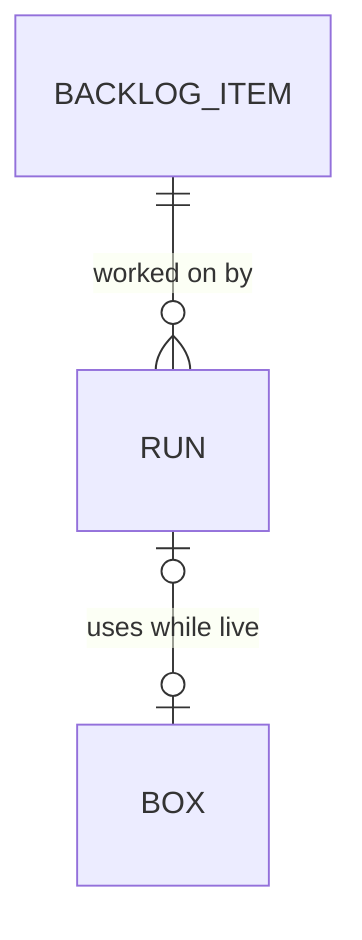
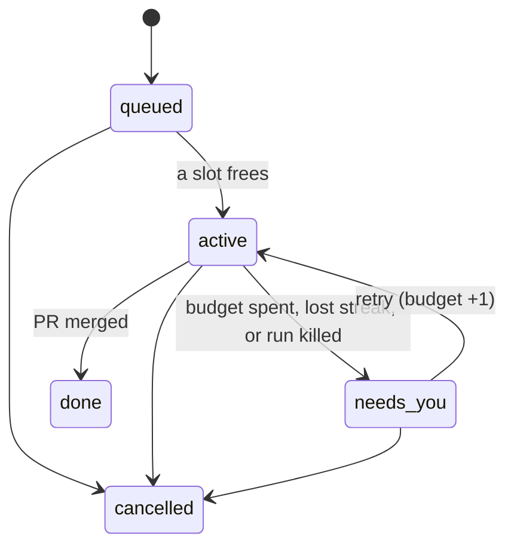
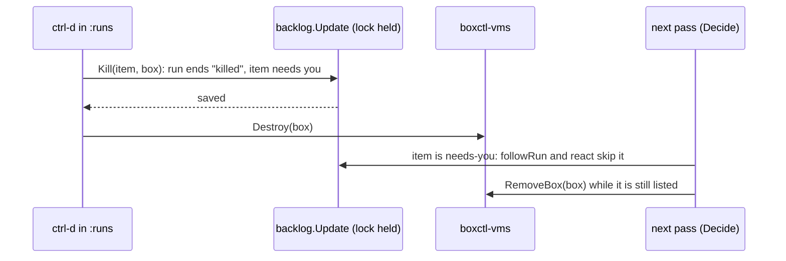

# Backlog and Runs - Plan

## Goal Capsule

- **Objective:** Someone driving goal-to-PR work from boxctl can tell at a glance what they asked for (each item and where it stands) and, separately, which boxes are working on it now and how earlier attempts ended.
- **Means:** Rename `queue` to `backlog` in the CLI and tui, and add a `runs` listing (`:runs`, `boxctl runs`) of every run, live and past.
- **Product authority:** The maintainer (cdalar). Decisions below were settled in the brainstorm session of 2026-11-20.
- **Open blockers:** None.
- **Stop conditions:** Stop and ask if a run in progress at upgrade can't be carried over without marking it lost (R4), or if a kill can't be recorded before its box is deleted (KTD4).
- **Execution profile:** One PR with code, tests and docs (U1–U6). An agent implements it, opens the PR and merges it once CI is green. The PR holding this plan stays open for review.

## Product Contract

### Summary

`boxctl queue` and the tui's `:queue` become two things: the **backlog**, one row per item (a goal on a repository that should end in a merged PR), and **runs**, one row per box that worked or is working on an item.
`boxctl queue` goes away with no alias.

### Problem Frame

"Queue" names the waiting stage only, while an item spends most of its life running, waiting on CI or waiting on you.
The `:queue` view also mixes two levels: its rows are items, but its RUN column shows only the item's current run.
An item that went through a code run, a failed attempt, a CI fix and a conflict fix shows one of those, and the rest are found one item at a time through describe.
Box actions (shell, logs, delete) for those runs live in `:boxes`, where a row doesn't say which item it serves or what kind of run it is.

### Key Decisions

- **Two views, not a rename alone.** Items and runs are one-to-many and take different actions, the k9s Deployment → Pods split. Governs R5, R8. (session-settled: user-directed — chosen over renaming `:queue` only: run history and box actions per run don't fit one item row.)
- **`:runs` shows past runs too.** Without them it's a filtered `:boxes`; the history is what earns a separate view. Governs R8, R11. (session-settled: user-approved — chosen over live-only and a live/past toggle.)
- **The CLI follows the tui, with no `queue` alias.** One vocabulary everywhere. Governs R1, R2, R3. (session-settled: user-directed — chosen over keeping a hidden `queue` alias and over a tui-only rename.)
- **Killing a run hands the item to you.** A deliberate kill is never followed by an automatic relaunch. Governs R10. (session-settled: user-approved — chosen over auto-retry and over cancelling the item.)

### Requirements

**CLI**

- R1. `boxctl backlog` replaces `boxctl queue` with the same subcommands (`add`, `ls`, `merge`, `cancel`, `retry`, `limit`), except that the headless loop `queue run` becomes `backlog dispatch`.
- R2. `boxctl queue` is removed: no alias, hidden or otherwise.
- R3. `boxctl runs` lists every run of every item, live and past, with the same rows as `:runs` (R8).

**Upgrade**

- R4. Items, priorities, slot limits and runs in progress before the upgrade carry over: a box already working on an item keeps being tracked and is not treated as lost.

**`:backlog`**

- R5. `:backlog` replaces `:queue`, one row per item, with today's item keys: `a` add, `m` merge, `r` retry, `+/-` priority, `L` slot limit, `o` open PR, `ctrl-d` cancel, `d` describe. `:queue` and its aliases are dropped.
- R6. Enter on an item opens `:runs` filtered to that item's runs.
- R7. `s` and `l` keep acting on the item's current run, as they do in `:queue` today.

**`:runs`**

- R8. `:runs` lists every run of every item, live and past, one row per run, showing at least its item, repository, kind (code, CI fix, conflict), box, state or outcome, and age.
- R9. A live run has the box keys: `s` shell, `l` logs, `d` describe, `ctrl-d` kill.
- R10. Killing a run deletes its box, ends the run with the outcome `killed`, and moves its item to needs-you with a note saying the run was killed; nothing launches for that item until you retry it.
- R11. A past run's describe shows its outcome, error and times; actions that need its box say the box is gone rather than failing.
- R12. `L` (slot limit) works in `:runs` too, since the limit counts runs.

### Relationship

### Acceptance Examples

- AE1. **Covers R6, R8.** **Given** item #3 had a failed code run, a successful code run and a running CI fix, **when** you press enter on #3 in `:backlog`, **then** `:runs` shows those three rows filtered to #3, the CI fix marked live.
- AE2. **Covers R10.** **Given** item #3's CI-fix run is live, **when** you press ctrl-d on it in `:runs` and confirm, **then** its box is deleted, the run shows `killed`, #3 shows needs-you with a "run killed" note, and later passes launch nothing for #3 until `r`.
- AE3. **Covers R11.** **Given** a past run whose box was deleted, **when** you press `s` on it, **then** the flash says the run's box is gone, and no ssh is attempted.
- AE4. **Covers R4.** **Given** item #5 has a run in progress on box `q5-code-1` before the upgrade, **when** the upgraded tui or `backlog dispatch` makes its next pass, **then** that run is still #5's current run and is not marked lost.

### Scope Boundaries

- No change to how items are decided, launched or merged, except the kill outcome in R10.
- `:boxes` is unchanged; run boxes still appear there as boxes.
- No live/past toggle in `:runs`; filtering it by state can come later.

### Outstanding Questions

None block the work. The four questions this contract deferred are settled in the Planning Contract: the state file and box prefix by KTD2 and KTD3, the kill's budget charge by KTD5, the `:runs` sort by KTD7, and the docs by U6.

### Sources

- `internal/queue/queue.go`: `Item`, `Run` (box, kind, started, ended, outcome, error are already stored per run), `Queue`.
- `internal/queue/engine.go`: `Decide`, and the box name `q<id>-<kind>-<n>`.
- `cmd/queue.go`, `cmd/queuerun.go`: the CLI and the run launcher.
- `cmd/tuiqueue.go`: today's `:queue` view, its columns and keys.

---

## Planning Contract

### Key Technical Decisions

- KTD1. **Rename the code as well as the commands.** `internal/queue` becomes `internal/backlog`, `queue.Queue` becomes `backlog.Backlog`, and the `cmd/queue*.go` and `cmd/tuiqueue.go` files and identifiers take backlog names. Someone who searches the code for the word on the screen finds it. Instantiates the CLI Key Decision (R1, R2). (session-settled: user-approved — chosen over renaming only the user-facing names: two words for one thing would last as long as the code.)
- KTD2. **The state moves to `~/.boxctl/backlog.json` on first use.** When `backlog.json` is missing and `queue.json` exists, `queue.json` is renamed to `backlog.json` and `~/.boxctl/queue/` to `~/.boxctl/backlog/` (the run logs). A rename keeps every item, run, limit, backoff and loop claim as it was, so a run in progress stays the item's current run (R4). It runs before `Update` takes its lock, and a rename that fails because the other process already did it is not an error. It refuses while an old binary may still be using `queue.json`: a loop claim held by another owner within `LoopStale`, or a `queue.json.lock` younger than `lockStale`. Two loops on two files would launch every item twice. (session-settled: user-approved — chosen over keeping `queue.json`: the file would be the only "queue" left.)
- KTD3. **Run boxes keep the `q<id>-<kind>-<n>` names.** `followRun` finds a run by its box name, so renaming the prefix would only affect new boxes and gains nothing. The box label `boxctl.queue` becomes `boxctl.backlog`, and the hidden `boxctl claude --queue-item` flag becomes `--backlog-item`. Nothing reads the label, and only the dispatcher's own binary passes the flag. (session-settled: user-approved — chosen over a `b<id>-` prefix: no reader, and old boxes would keep the old one.)
- KTD4. **A kill is recorded first, under the lock, then the box is deleted.** `backlog.Kill(it, box, now)` is pure, in the package with `Decide`. It requires the item's current run to be on `box`, ends that run with the new outcome `OutcomeKilled` (`"killed"`), and sets the item to needs-you with the note `run killed (<kind> on <box>)`. The tui calls it inside `backlog.Update` and calls `Client.Destroy` only after the save. This order keeps a pass from seeing the box gone while the run is still current, which `followRun` would end as lost and relaunch. A launch that returns later finds no current run and records nothing. If `Destroy` fails, or the tui quits before it runs, the pass deletes the box: `Decide`'s step 3 emits `RemoveBox` for every listed box of a run whose outcome is `killed`, whatever the item's state, so whichever process runs the loop retries the delete. Governs the mechanism of R10.
- KTD5. **A killed run counts against its kind's budget.** `Item.Used` already counts every ended run that wasn't lost, so `killed` counts with no change. Retry still adds one to the budget, so an item that was killed can always run again. (session-settled: user-approved — chosen over leaving kills uncharged: a deliberate stop is the user's call, not a lost box.)
- KTD6. **Kill only a run whose box exists.** ctrl-d on a run whose box is not in the tui's box listing yet flashes `#<id>'s run isn't up yet` and does nothing. Deleting a box that a `boxctl claude` child is still creating could leave Claude on a box nobody tracks. (session-settled: user-approved — chosen over cancelling a launch mid-way.)
- KTD7. **`:runs` is built from the backlog, joined to the box listing.** One row per `Item.Runs` entry, keyed `<item>/<n>`. A live run (no `Ended`) takes its state from its box: `run_status`, else the box state. When its box isn't listed, it shows `starting` while `Launched` is false and `gone` once it is true, which the next pass ends as lost. A past run shows its outcome. The default order puts live runs first, then the newest start first. No new storage is needed: `Item.Runs` already keeps kind, box, start, end, outcome and error.
- KTD8. **Drill-down is an item scope on the page, not a filter.** `page` gains an `item int` (0 for all), and `:runs` rows read it, so `#3` never matches `#31`. The crumb and title show `runs(#3)`. Enter on an item in `:backlog` pushes `:runs` with that scope. Esc pops back to `:backlog`. `:runs` typed at the prompt is unscoped. (session-settled: user-approved — enter opens the runs, and `d` keeps describe.)
- KTD9. **`boxctl runs` shares its rows with `:runs`.** One function builds the row cells from a backlog and a box listing, and both the command and the view use it. The command needs one `List` call for live state. If that call fails, live runs show `?` with a warning on stderr rather than failing the listing.

### High-Level Technical Design

Item states, including the kill. These are directional sketches, not code.

The order of a kill (KTD4):

### Assumptions

- An old `boxctl queue run` or tui still open at the upgrade blocks the migration (KTD2) until it is closed or its claim goes stale. The README tells users to stop it before upgrading.

---

## Implementation Units

### U1. Rename the package and carry the state over

- **Goal:** `internal/queue` becomes `internal/backlog`, and an existing `queue.json` and its logs move to the backlog names on first use (R4).
- **Requirements:** R4; KTD1, KTD2, KTD3.
- **Dependencies:** None.
- **Files:**
  - `internal/queue/` moves to `internal/backlog/` (`backlog.go`, `engine.go`, `engine_test.go`), with `Queue` renamed `Backlog`
  - `cmd/queuerun.go`: `queueLogPath` moves under `backlog/logs`, `queueLaunchArgs` passes `--backlog-item`
  - `cmd/claude.go:72,153` and `cmd/claudegoal.go:410` get the flag and label
  - `cmd/queue.go`, `cmd/queue_test.go`, `cmd/tui.go`, `cmd/tuiqueue.go`: the import path and the `Queue` → `Backlog` identifiers only, so U1 builds alone (the file renames are U2's and U4's)
- **Approach:** `Path()` returns `~/.boxctl/backlog.json`. A `migrate(dir)` helper, run once per process before the first `Load` or `Update`, renames `queue.json` and `queue/` when `backlog.json` is missing, unless KTD2's in-use check refuses: then it fails with an error naming the holder and saying to stop the old `boxctl tui` or `queue run` first. A `queue.json.lock` older than `lockStale` is removed. The lock-held error message names the new file. Box names stay `q<id>-…` (KTD3).
- **Test scenarios:**
  - A dir with `queue.json` (an item whose current run is on `q5-code-1`, launched) and `queue/logs/q5-code-1.log`: after `migrate`, `backlog.json` holds the item with the same current run, and the log is under `backlog/logs/`. Covers AE4.
  - A `Decide` pass on that migrated state, with `q5-code-1` reporting `running`, keeps the run current and doesn't end it as lost. Covers AE4.
  - Both `backlog.json` and `queue.json` exist: nothing is renamed, and `backlog.json` wins.
  - Neither file exists: no error, and an empty backlog.
  - `queue.json` whose loop claim is held by another owner and seen 30s ago: `migrate` fails naming the holder, and nothing is renamed.
  - The same with the claim seen 5 minutes ago: it migrates.
  - A `queue.json.lock` 1s old: `migrate` fails, and the lock is left alone.
  - `queueLaunchArgs` (renamed) contains `--backlog-item 5`.
- **Verification:** `go test ./internal/backlog/... ./cmd/...` passes. `grep -rn 'internal/queue' .` finds nothing.

### U2. `boxctl backlog` and `boxctl runs`, with no `boxctl queue`

- **Goal:** The CLI has `backlog` (`add`, `ls`, `merge`, `cancel`, `retry`, `limit`, `dispatch`) and `runs`, and has no `queue` (R1–R3).
- **Requirements:** R1, R2, R3; KTD1, KTD7, KTD9.
- **Dependencies:** U1.
- **Files:**
  - `cmd/queue.go` becomes `cmd/backlog.go`
  - `cmd/queuerun.go` becomes `cmd/backlogdispatch.go`
  - new `cmd/runs.go`
  - `cmd/queue_test.go` becomes `cmd/backlog_test.go`
- **Approach:** Rename the command tree and its help text. A bare `boxctl backlog` stays the listing, as a bare `queue` is today. `queue run` becomes `backlog dispatch`. `runs` prints the KTD9 rows, with `-o json` from `addOutputFlag`, as `backlog ls` has. No alias, hidden or otherwise (R2).
- **Test scenarios:**
  - `boxctl queue` is an unknown command.
  - `boxctl backlog dispatch --help` works, and `boxctl backlog run` is unknown.
  - The rows for a backlog with item #3 (a failed code run, a done code run, a CI run whose box reports `running`): three rows, the CI run first and live, then newest first.
  - The rows when the box listing failed: live runs show `?`, and past runs show their outcome.
  - The existing `queue_test.go` cases pass under their new names.
- **Verification:** The tests pass. `go build -o boxctl . && ./boxctl backlog --help && ./boxctl runs` work by hand.

### U3. Kill in the model

- **Goal:** A killed run ends `killed`, its item needs you, and no pass relaunches it until retry (R10).
- **Requirements:** R10; KTD4, KTD5.
- **Dependencies:** U1.
- **Files:**
  - `internal/backlog/backlog.go`: `OutcomeKilled`, `Kill`
  - `internal/backlog/engine_test.go`
- **Approach:** `Kill` is pure and returns an error when the item has no current run on that box. Needs-you items are already skipped by both `followRun`'s current-run check and `react`. `Decide`'s step 3 gains the killed-run cleanup from KTD4.
- **Test scenarios:**
  - Item #3 with a live CI run on `q3-ci-1`: `Kill` sets the run's outcome to `killed`, sets `Ended`, sets the state to needs-you, and sets the note to `run killed (ci_fix on q3-ci-1)`. Covers AE2.
  - After the kill, a `Decide` pass with `q3-ci-1` absent from the boxes and free slots ends no run as lost and launches nothing for #3. Covers AE2.
  - After the kill, a pass with `q3-ci-1` still listed returns `RemoveBox` for it and launches nothing for #3.
  - The same, then retry: the next pass launches a CI run, because `Used(CIFix)` counts the kill and `Budget` grew by one (KTD5).
  - `Kill` with a box that isn't the current run's, or with no current run, returns an error and changes nothing.
- **Verification:** `go test ./internal/backlog/...` passes.

### U4. `:backlog` replaces `:queue`

- **Goal:** The tui's item view is `:backlog`, with today's keys, enter opening the item's runs, and `s`/`l` on its current run (R5–R7).
- **Requirements:** R5, R6, R7; KTD1, KTD8.
- **Dependencies:** U1, U5 (enter pushes `:runs`).
- **Files:**
  - `cmd/tuiqueue.go` becomes `cmd/tuibacklog.go`
  - `cmd/tui.go`: the `"queue"` resource cases at lines 288 and 424
  - `cmd/tuiactions.go:293`: key dispatch
  - `cmd/tuiviews.go`: `tuiViews`
  - `cmd/tui_test.go`
- **Approach:** View name `backlog`, with no short alias: `b` is already `:boxes`'s. `queue`, `q`, `goals` and `work` are dropped. `enter` pushes the runs view scoped to the item, and `d` keeps describe. Keep the background pass every `queuePassEvery` (renamed), whatever view is open.
- **Test scenarios:**
  - `:backlog` shows items, and `:queue` flashes an unknown view.
  - Enter on #3 pushes a runs page with item scope 3 and title `runs(#3)`. Esc returns to `:backlog` with the cursor on #3. Covers AE1.
  - `d` on #3 still pushes the describe page.
  - `a`, `m`, `r`, `+`, `L` keep their current tests under the new view name.
- **Verification:** `go test ./cmd/ -run TestTui` passes.

### U5. `:runs`

- **Goal:** A view of every run, live and past, with box keys on live runs and a kill (R8–R12).
- **Requirements:** R8, R9, R10, R11, R12; KTD4, KTD6, KTD7, KTD8.
- **Dependencies:** U1, U3.
- **Files:**
  - new `cmd/tuiruns.go`
  - `cmd/tui.go`: `page.item`
  - `cmd/tuiviews.go`: `tuiViews`
  - `cmd/tuiactions.go`: `askDestroy`'s pattern at line 667 for the confirm
  - `cmd/tui_test.go`
- **Approach:**
  - Columns: ITEM, REPO, KIND, BOX, STATE, AGE (KTD7 rows).
  - `s` and `l` act on any run, live or past, whose box is in `m.vms`, as `:queue`'s do today. When the box isn't listed they flash `#<id>'s <kind> run ended <outcome>; its box is gone` for a past run (R11), or that it isn't up yet for a live one.
  - ctrl-d acts only on a live run whose box is in `m.vms` (KTD6). A live run shown `gone` flashes that its box is missing.
  - `d` shows the run: item, kind, box, started, ended, outcome, error.
  - ctrl-d asks `kill #3's ci_fix run on q3-ci-1?` and on yes calls `Kill` under `backlog.Update`, then `Destroy` (KTD4). It then asks for a pass so the views refresh at once. If `Destroy` fails, the flash gives the error and says the run is recorded as killed and the next pass deletes the box.
  - `L` is the backlog's limit dialog (R12).
- **Test scenarios:**
  - A backlog with #3 (failed code, done code, live CI) and #31 (one run): `:runs` lists 4 rows. The scope-3 page lists #3's 3 rows with the CI run first and live, and none of #31's. Covers AE1.
  - ctrl-d on #3's live CI run against the httptest server, then confirm: the saved backlog has the run `killed` and #3 needs-you, and the server saw `DELETE` for `q3-ci-1` after the save. Covers AE2.
  - ctrl-d on a run whose box isn't listed yet flashes "isn't up yet", and the server sees no request (KTD6).
  - `s` on a past run whose box isn't listed flashes that the box is gone and runs no ssh. Covers AE3.
  - `l` on a past failed run whose box is still listed opens its logs.
  - ctrl-d confirmed while the server answers `DELETE` with 500: the run stays `killed`, and the flash gives the error.
  - `d` on a past failed run shows its outcome and error (R11).
  - `L` in `:runs` opens the limit dialog (R12).
- **Verification:** `go test ./cmd/ -run TestTui` passes, and a manual run of `./boxctl tui` with `:runs` works.

### U6. Docs and help

- **Goal:** Every user-facing and contributor text says backlog, runs and dispatch, and `queue` appears only where it's still true (`q<id>` box names).
- **Requirements:** R1–R12 (documentation of each).
- **Dependencies:** U1–U5.
- **Files:**
  - `README.md`: lines 22, 34, 41 and the "The queue" section at lines 470–508, which becomes "The backlog", plus a note to stop an old `boxctl queue run` or tui before upgrading
  - `AGENTS.md`: the `internal/queue/` entry, the `claudepr.go` mention of `:queue`, and the tui entry's "queue goal"
  - the tui help page (`cmd/tuirender.go` and `cmd/tuiviews.go` hotkeys)
- **Approach:** Rename in place. The README section describes `:runs`, kill, and where state and logs now live.
- **Test expectation:** none, because these are docs. `grep -rn -i queue README.md AGENTS.md cmd internal` should find only the exceptions the Definition of Done lists.
- **Verification:** A read of the README section and `boxctl backlog --help`.

---

## Verification Contract

| Gate | Command | Proves |
|---|---|---|
| Format | `gofmt -s -l .` (empty output) | build.yml |
| Modules | `go mod tidy && git diff --exit-code` | go.mod untouched |
| Vet | `go vet ./...` | |
| Tests | `go test -count=1 -race -shuffle=on ./...` | U1–U5 scenarios, AE1–AE4 |
| Lint | `golangci-lint run ./...` | errcheck on new `Fprintf`s, among others |
| Vulns | `govulncheck -test ./...` | vuln.yml |
| Manual | `go build -o boxctl . && ./boxctl backlog && ./boxctl runs && ./boxctl tui` (`:backlog`, enter, `:runs`) | the views render against a real account |
| Rename sweep | `grep -rn -E 'internal/queue\|boxctl queue\|:queue' . ` | no stale references outside this plan and the README's upgrade note |

## Definition of Done

- All Verification Contract gates pass locally and in CI.
- AE1–AE4 each have a passing test (U1, U3, U4, U5).
- `boxctl queue` and `:queue` are gone, and nothing aliases them (R2, R5).
- An existing `~/.boxctl/queue.json` with a run in progress upgrades with the run still current (R4, AE4).
- README and AGENTS.md describe backlog, runs, dispatch and kill.
- No code is left from abandoned attempts.
- No `queue` names remain except the `q<id>` box prefix, the `queued` item state (its `Queued` constant and stored value, kept so migrated items still launch, R4), `migrate`'s `queue.json`, `queue/` and `queue.json.lock`, and the README's upgrade note.
- The PR is open with the CI checks green, and merged per the workflow.
